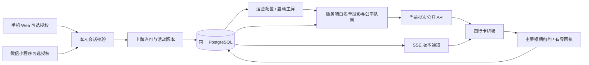

# 遇见卡牌墙 MVP · 运行与交接

日期：2026-10-12。属于原统一应用的增量功能，不是新建的会员系统。Web、微信小程序、运营后台和大屏继续共用原服务端与 PostgreSQL。

## 入口与操作

| 使用者 | 路径 | 操作 |
| --- | --- | --- |
| 手机 Web | `/mobile/member-wall-consent?activity=meet` | 先进入活动完成资料；确认昵称，预览正反面后自愿开启；可单独停止展示 |
| 小程序 | 已有主流程中的“我的遇见卡牌” | 同一服务、本人 Bearer 身份、相同许可版本和字段范围 |
| 运营 | `/admin/member-wall?activity=meet` | 沿用运营登录；选择模式、周期、比例、固定六列布局和轮播开关；展开查看累计展示秒数 |
| 主屏 | `/display/member-wall?activity=meet` | 同一浏览器先登录运营，再点击“启动主屏”；可点击全屏 |
| 只读屏 | 同主屏路径 | 无运营登录仍可读取当前有效批次；不能写配置或累计曝光 |
| 演示 | `/display/member-wall/preview?state=motion&count=50` | 不连接真实会员；底部状态标注“演示预览”，顶部不显示演示标签 |

预览状态支持 `front/back/low/empty/offline/motion`，人数支持 `10/28/50/200`。`low` 固定 8 人；空/断网预览不展示成员。演示页不显示二维码占位；只有有效入口二维码才显示扫码区域。

实际活动使用服务端 `DESTINY_PUBLIC_URL` 生成入口二维码；启用已配置的微信能力时使用真实小程序码。小程序 AppID/AppSecret、HTTPS 合法域名和微信真机验收尚未具备时，本机手机验证使用 Web 入口。

## 三端联动

照片公开许可、邀请配对许可和卡牌许可相互独立。历史参与者不自动上墙，同舟机构资料及相册不作为候选源。

## 公开字段

- 仅昵称、本人资料性别标识、白名单年龄段、20 个已有系统虚拟头像（MW遇见码仅保留后端与运营兼容，不在卡片显示），以及 q3/q5 两项正面标签、q5/q6/q8/q9 四项背面偏好。
- 答案只能取自现有合法选项，未答项省略。没有完整题干、联系方式、内部备注、同舟资料、内部认证身份或真实照片地址。
- 用户昵称限 1–8 个字符，拒绝明显联系方式、网址和控制字符。机器校验不能识别所有真实姓名，因此用户须主动确认使用昵称。
- 新公开 ID 与遇见码不能用于登录、邀请或读取私密资料。

## 调度和数据有效期

默认 10 秒翻面、40 秒换人检查、25% 替换。t40 先翻回正面，等待整个错峰翻转完成后再淡出换人；6 列约 t41.4 秒发生替换。比例可选 25/50/100%。少于容量的候选不强行换人。

每侧各12席，分别按累计可见时长、最后展示时间、加入时间、稳定公开 ID 排序。组间人数不同时，各组完整轮播周期可以不同。新授权者在下一次换人周期加入。停止展示/离场/暂停/删除后先清除卡片，空位在下一次换人周期补充。

每个活动只有一个主屏租约，5 秒心跳、最长 15 秒有效期；回执包含批次和递增序号，服务端只累计分配且仍符合许可的成员，重放不重复计时。隐藏页面、不可读窗口和超时回执不补计。它是客户端可见时间汇总，**不是观看人数或真人注视时长证明**。

SSE 用于及时通知，5 秒校验作为补充。收到撤销快照立即移除；断网最迟在本地许可有效期结束后清空。恢复先重新读取，旧请求不能重新填回已撤销卡片。主屏隐藏或关闭会丢弃本地租约；恢复后待原租约到期，再点击“启动主屏”。修改配置也需要重新启动主屏，以统一新周期。

## 数据库与启用

先执行既有迁移入口 `scripts/live-init.ts`（现已纳入 007），再在受保护的运行配置中设置 `DESTINY_MEMBER_WALL_ENABLED=true`。默认值仍为 false。新页面、API 与前端全部包含在原应用构建中，不增加运行服务或数据库。

新增四张表：`dl_member_wall_consents`、`dl_member_wall_config`、`dl_member_wall_exposure`、`dl_member_wall_sessions`。迁移不回填旧用户许可，不修改原答案、邀请、机构档案表结构。

发布顺序：备份数据库 → 执行 007 → 验证旧数据摘要未变 → 用新构建启动应用 → 验证健康检查、权限、空白真实墙、手机入口和二维码。不得把隔离测试的 50/200 人样例复制到真实活动。

回退首选关闭功能并启动上一构建，保留新增表。`ROLLBACK.sql` 仅删除本功能表，属于数据删除操作；需有备份和明确数据处置确认后人工执行。

## 本次交付边界

本轮更新 Mac 局域网 UAT，不部署公网、不创建收费资源、不覆盖此前 Docker 交付包。新的镜像/部署包应在后续明确打包时另取版本。现场 85/86 英寸、3–5 米辨识与扫码，以及真实微信账号流程必须另外实测。

证据见 `MVP_ACCEPTANCE.md`、`VISUAL_QA.md` 与 `../verification/member-wall/`。

## 本机 UAT 当前版本

入口 `http://192.168.130.201:3216`，活动 `meet`，构建 `.next-memberwall-age` / `FYHf3tTcXi2qb2IMim-wM`。同一 Wi-Fi 的手机使用 `../verification/member-wall/uat-join-qr.png`。首次真实上墙必须由手机本人开启“我的遇见卡牌”，并由已登录运营的大屏窗口点击“启动主屏”。不启动主屏时公开墙没有分配批次。

运行配置 `~/.config/destinylab/2026-10-11-lan/member-wall-uat.env`，日志及 PID 位于同目录；原构建、原配置和新增表均保留可回退。不要把配置或备份复制进 Git 仓库或部署包。

2026-10-12 底部精简更新：删除公开范围说明与无效二维码占位，有效扫码入口保留。验证见 `../verification/member-wall/footer-check.json`；上一版 `.next-memberwall-verified` 保留用于回退，无数据库迁移。

## 人数与许可范围 v2

顶部总人数/男生人数/女生人数均来自当前活动全部参与者，缺失性别只计入总人数；卡片数和上墙候选数不替代活动人数。卡片性别来自本人资料，与所选虚拟头像无关。正背面均以深蓝灰/玫瑰酒红及文字标识区分。

许可版本升级为 `member-wall-2026-10-12-v2`，旧 v1 许可不会自动公开性别，需本人通过更新后的 Web/小程序重新预览确认。旧记录保留，无数据库迁移。回退旧版本时应先关闭卡牌墙并核对许可版本，避免误启用历史 v1 许可。

## 固定六列与旧主屏升级

每行从左到右为男、男、男、女、女、女，共四行。每侧保留12席，不跨侧补位。默认25%每组最多换3人，50%每组最多6人，100%每组最多12人；总人数/男生/女生统计仍覆盖整个活动。

批次记录使用固定24项公开ID/null槽位，空位不计曝光；真实候选由服务端分组，演示使用同一算法。撤销或性别变更后原位置立即清空，稳定换人阶段才补位。旧容量或旧形状批次返回无效，刷新大屏并点击“启动主屏”重新领取；旧列数配置兼容归一到6列。不需要结构迁移或重新授权，v2公开范围保持。

本轮验收时 Mac 的 en0 地址变更为 `192.168.130.201`，受保护的 UAT origin 配置与 `uat-join-qr.png` 已同步；小程序构建也使用该局域网 API 地址。旧截图/历史证据中的 192.168.43.70 已非当前入口。

## 普通电脑窗口适配

按内容区宽高同比缩放六列四行与字号间距，已验证900×600至3840×2160；手机竖屏仍保留尺寸保护。UAT演示入口 `/display/member-wall/preview?state=motion&count=50`，展示50名模拟参与者及24席轮播。上一版 `.next-memberwall-six` 保留用于回退。

## 背面四项答案与许可 v3（当前）

背面为周末偏好、见面看重、沟通方式、关系期待，来源q5/q6/q8/q9。正反面公开并集为q3/q5/q6/q8/q9；旧v2不涵盖q6/q9，必须由本人重新预览确认v3，历史记录不删除。无需数据库迁移。3216已更新，活动与许可数据指纹前后一致。

上一构建`.next-memberwall-window`保留；如回退，先暂停真实卡牌墙并核对许可版本，避免旧程序重新接受历史v2。验收见`../verification/member-wall/four/`。

当前背面视觉精简构建为`.next-memberwall-backtype`，前一`.next-memberwall-four`保留回退；许可仍为v3，本轮无需重新确认。正面年龄替换另有待确认计划，当前正面仍为遇见码。

## 年龄段与v4许可（当前版本）

当前构建`.next-memberwall-age`，正面为用户实际选择的年龄段，缺失不显示。v4新增公开年龄段，旧v3须本人重新确认；字段仍来自统一活动数据库，不读取同舟私有资料，不进行DDL。`.next-memberwall-backtype`保留回退；跨许可版本回退前暂停真实墙并核对历史授权。本轮活动/许可数据指纹未变。
