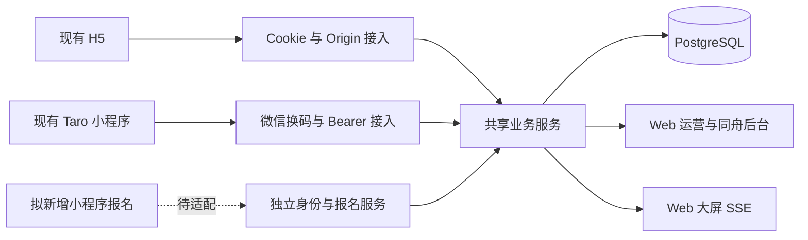

# H5 → 微信小程序：当前代码审计

日期：2026-10-12。实际工程：`/Users/lvyong198201/Desktop/Game 2026/DestinyLab-MVP`。

输入资料为用户附件《Codex_缘分实验室_H5迁移微信小程序_实施提示词.md》。附件描述目标，不直接替代新范围的计划确认。本轮仅只读调查、无输出类型检查和文档编写；未修改业务代码、构建配置或UAT运行状态。

## 核心结论

项目已经存在独立 `miniapp/` Taro 客户端、微信登录换码、Bearer会话与共享服务。正确路线是继续这一工程、补齐差距，不新建 `apps/weapp` 与现有代码并行，也不重写服务端和数据库。

最新H5新增的报名、可选生活资料、相册及签到尚未进入小程序。尤其 `miniLogin` 当前直接创建活动参与者；不能直接用于预报名身份，否则微信登录就会增加现场人数。新增预报名必须区分微信身份建立、报名、签到与现场入场。

## 已核对的架构和依赖

- 根项目：Next.js 16.3.8、React19.3、TypeScript、pg/PostgreSQL、sharp；Web大屏使用Three.js。Docker运行Web页面与API，数据库独立持久化。
- `miniapp/package.json`：Taro4.3.0、React18.3.1、TypeScript5.9.3；独立依赖及锁文件。`config/index.ts`已经引用根`src`共享题库、类型和业务选择器。
- 小程序唯一物理路由为`pages/index/index`；资料、答题、推荐、详情、邀约、同舟、头像和卡牌授权通过组件/状态切换。不能把这些视为已具备独立导航与分享的多页客户端。
- 小程序：`/api/mini/*` → 微信身份/令牌适配 → 既有execute/snapshot/同舟/头像/卡牌服务 → 同一PostgreSQL。
- H5：`/api/live/*`使用Cookie和Origin；报名使用独立`/api/registration/*`会话；不能为了小程序复用而关闭Web Origin校验。
- 大屏/后台：继续Web；大屏订阅SSE版本，客户端小程序前台约2秒轮询、失败退避、后台停止，写入幂等和版本门已经存在。

## 用户页面与迁移矩阵

| H5路由 | 小程序当前证据 | 处置 |
| --- | --- | --- |
| `/mobile/01-start` | index欢迎态、登录、首题 | 保留规则，适配独立首页/活动上下文 |
| `/mobile/02-result` | result状态分支 | 适配页面反馈和返回 |
| `/mobile/03-profile` | Profile组件，昵称/性别/年龄/愿意接收 | 保留校验与保存，适配独立页面 |
| `/mobile/04-question` | QUESTIONS直接共享、逐题提交、回看、服务返回 | 保留十题内容，完善导航/状态恢复 |
| `/mobile/05-discover` | recommendations与服务端允许推荐ID | 保留现有算法 |
| `/mobile/06-common` | detail分支、commonAnswers | 保留共同选项，视觉适配 |
| `/mobile/07-invitation` | InviteFlow发送/接受/拒绝/取消 | 保留状态机 |
| `/mobile/08-mutual` | 已互相同意及等待相遇点状态 | 保留，不另造确认规则 |
| `/mobile/09-meet` | 相遇点、相认码、出发/到达/见面与帮助 | 保留动态点位；Meet01是配置值，不硬编码 |
| `/mobile/10-next-step` | 下一站/继续探索等InviteFlow分支 | 对照实际状态逐项验收 |
| `/mobile/tongzhou` | ServiceForm、提交/修改/撤回/删除 | 已有代码，但与此前UI移除撤回的产品要求存在差异，需要统一 |
| `/mobile/member-wall-consent` | MemberWallConsent及专用API | 复用当前卡牌授权规则 |
| `/mobile/register` | 无对应页面或API适配 | 新增范围：七屏报名、私人资料、相册、签到后进入 |
| 头像编辑 | AvatarEditor，虚拟头像与选图/裁剪/上传 | 已有；新选照片仍setAllow(false)，与此前默认上屏要求需核对，不能按附件移除已有选图能力 |
| `/admin/*`、`/agency/tongzhou`、`/display/*`、`/screen/*` | Web运营、机构、大屏 | 不迁入小程序 |
| `/tongzhou/p/[slug]` | 现有公开H5个人主页 | 本轮保持H5；若要原生个人主页分享，应单独明确范围 |

相认码已有代码。未发现独立“纪念卡生成/保存”小程序页面，通用核销不是既有客户端功能；不得将其标记为已迁移完成。

## 平台适配与差距

- 浏览器DOM、Next Link、window.scrollTo/location/confirm、HTML表单/file输入、backdrop-filter不能直接照搬。使用Taro组件、路由、页面滚动、对话框和图片选择/预览能力。
- H5 EventSource/visibility事件不直接复用；现有Taro生命周期和轮询可保留。已有Taro存储/令牌清理和过期处理，不新增明文管理员凭据。
- 题库、纯校验、DTO/类型及状态选择器可复用；页面布局、导航和平台交互需适配。报名服务要提取可信调用上下文，不能伪造Cookie或忽略Origin。
- AvatarEditor已有相册选择与裁剪压缩，私有照片经带身份下载后在临时文件展示；个人多图相册是另一条业务，不能混同头像。
- 未发现`useShareAppMessage`/`onShareAppMessage`/`useShareTimeline`，分享待实现。scene已解析并经服务端查活动，来源归因尚未见完整实现；分享参数不可携带身份令牌或私人资料。
- Three.js大屏渲染保留Web，不需要搬到小程序。移动端动效应按意图替换，需实机验证；没有证据证明H5复杂CSS/Canvas已原样兼容。未发现小程序低动效配置开关。
- 小程序`assertOrigin`当前只允许HTTPS或本机localhost/127.0.0.1 HTTP；现有LAN H5地址不能直接当作已获支持的小程序真机API。不得将开发者工具关闭域名校验当成上线方案。
- `project.config.json`仍是`touristappid`、urlCheck=true；没有本轮真实AppID、主体/类目、开发者权限、可用HTTPS域名或实机预览证据。AppSecret仅服务端保护配置，不要求发到聊天中。
- README/旧MINI_UAT部分段落记录的是历史版本（旧端口、头像默认行为等），需要按当前代码更新，不能直接作为当前验收事实。

## 技术路线比较

| 方案 | 本项目实际代价 | 结论 |
| --- | --- | --- |
| 继续Taro React | 复用已存在客户端、React组件、TS纯逻辑、微信API适配和测试 | 推荐；延续已用技术，不升级框架作为本轮目标 |
| uni-app Vue | 增加Vue栈并重做已有React界面、会话接入 | 暂无迁移收益证据 |
| 原生小程序 | 可直接组织原生页面，但需改写现有React客户端与组件 | 仅局部Taro能力不足时评估 |

保持`miniapp/`与根Next工程现状；暂不做monorepo目录搬迁。共享纯逻辑继续现有alias，遇到明确构建边界问题再提取packages/shared。

## 验证证据与未完成项

本轮执行`tsc --noEmit --incremental false -p miniapp/tsconfig.json`，退出码0，类型检查通过。上一轮H5报名已完成130项领域测试、生产构建与浏览器UAT；这些证据不能替代小程序构建、微信登录、分享或真机验收。本轮不覆盖正在使用的构建产物，不宣称重跑了全部lint/test/build。

尝试读取Taro React及微信官方网络/登录文档，当前抓取失败。最新平台资质、隐私与域名要求尚未完成官方核验，实施/提审前须结合实际账号再次核对，不能据此宣称符合最新审核要求。

待交付架构、逐页视觉映射、测试验收、发布检查清单将在计划确认后按批次补齐，不用空白文档充当交付完成。
