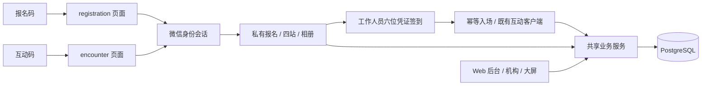

# 小程序双入口架构（2026-10-13）

同一个 Taro React 小程序，报名与现场互动分别使用小程序码。后端和数据库不分叉，Web H5、运营、同舟与大屏继续运行。

- `miniLogin` 只创建微信身份、身份级会话和空报名关联，不创建参与者。
- 新会话保存在 `dl_mini_identity_sessions`；身份与活动的报名关联保存在 `dl_wechat_registrations`，唯一约束阻止一份报名绑定多个微信身份。登录凭据仅存摘要，AppSecret 不下发。
- 小程序端通过 Bearer 会话获得服务端生成的 `mini:<identity>` owner key，复用报名校验与事务；owner key 不接受前端输入。H5 继续 Cookie/Origin 路径。
- `registrationEnterActor` 是 H5 与小程序共用的签到入场规则，校验当前活动 epoch。小程序可恢复该微信身份原有参与者；未验证手机号不用于绑定旧 H5 档案。
- 一名用户可有多个有效身份会话，最长七天，退出撤销当前会话。401 要重新微信登录；活动重置后需重新签到。
- `012-mini-registration-entry.sql` 保留旧码 scene，回填 encounter，主键扩展为活动/AppID/环境/入口。新码直接指向不同原生页面，resolve 只返回活动和入口类型。
- 第四站无写操作：读取服务端档案；前三站保存成功后前进，失败保留编辑、提供重试；从第四站编辑保存后返回。
- 全生日只存在私有报名记录；分享参数无个人资料；公开个人宣传页仍沿用既有 H5。

构建交付分为微信包和服务端 Docker。数据库迁移是独立显式操作，不随应用启动执行。真实 AppID 未提供，本轮不执行微信提审、正式发布或生产切换。

## 公开昵称与头像检测

新增 013-mini-content-review.sql 保存审核状态和异步回调结果。原生端公开昵称必须通过 msg_sec_check，上传头像先以短期能力链接交给 media_check_async，安全模式 JSON 回调通过签名/AES/AppID 校验后持久化结果；只有服务器 pass 状态允许绑定头像。私有报名相册不因上传自动成为公开头像。详细见 10-content-security.md。
