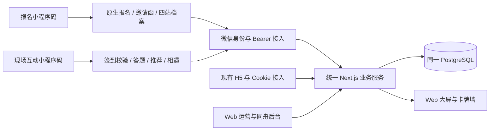

# 微信小程序发布就绪审视与工作量评估

日期：2026-10-13。实际代码目录：`/Users/lvyong198201/Desktop/Game 2026/DestinyLab-MVP`。
状态：只读审查完成，实施方案待确认；本轮未修改业务代码、配置、数据库或运行服务。

## 结论

可以沿用现有 Taro 工程进行增量改造。统一 Next.js 后端、PostgreSQL、Web 运营后台、同舟机构后台和大屏继续复用。当前已有小程序互动底座，但不具备最新 H5 完整报名旅程，也没有真实微信发布验收证据，不能直接打包提审。

用户本轮明确“是要分开，到时候应该是不同的入口”“不同的二维码不同的入口”。按同一个小程序、两个独立入口设计：报名码进入报名与私人档案，现场互动码进入签到状态校验与现场互动。共用账户及业务数据，不因此拆成两个小程序或两个数据库。

## 当前证据与差距

| 模块 | 当前证据 | 发布改造 |
| --- | --- | --- |
| 客户端 | `miniapp/package.json`：Taro 4.3.0、React 18；`app.config.ts` 仅注册 `pages/index/index` | 建立独立入口、多页导航、分享返回和品牌组件，保留已实现业务 |
| 微信接入 | `wechat-provider.ts` 有真实换码、小程序码生成；项目配置仍为 `touristappid` | 接入实际账号及 HTTPS 环境，验证登录、码生成和真实扫码 |
| 报名 | H5 有报名、六位凭证、电子邀请函、四站档案、年月日/星座 | 补原生页面与 Bearer 授权 API；保留姓名在前、私有生日和保存语义 |
| 身份 | `miniLogin` 首次登录直接创建现场参与者和 JOIN 事件 | 微信身份、报名记录、工作人员签到、现场入场分别处理；仅登录不能增加现场人数 |
| 二维码 | `dl_wechat_entry_codes` 主键为活动/AppID/版本；`generateWechatCode` 固定 index；resolve 只返回活动 | 增加入口类型及对应页面；同活动生成两张不同码，旧码兼容 |
| 现场互动 | 已有十题、推荐、共同答案、邀约、双向见面、下一站及生命周期轮询 | 多页视觉适配、状态恢复、双手机并发、弱网与活动重置验证 |
| 照片与同舟 | 已有头像上传、私有下载和同舟表单；小程序仍有撤回文案、新选头像默认不公开 | 对齐已确认的产品交互；相册与头像分离，保留服务端权限和明确公开范围 |
| 分享 | 未检索到原生分享钩子；已有 scene 解析 | 两个入口各自分享，仅携带活动/入口标识；不携带登录令牌、电话或生日 |
| 隐私与公开内容 | 有业务同意开关及头像上传的平台隐私授权调用；完整平台声明/拒绝路径尚未真机核验，内容检测未接入 | 核对实际平台声明、接口同意及拒绝路径；补公开昵称/照片/文字的审核状态与人工处理 |
| 公网服务 | 客户端只接受 HTTPS 或本机回环 HTTP；LAN IP 的 HTTP 不被接受 | 真实 HTTPS、合法域名及上传下载配置；Mac H5 局域网二维码不是微信体验版码 |
| 交付包 | `DEPLOYMENT_HANDOFF.md` 对应 2026-10-11，迁移至 006；当前源码已有 011 | 重新生成配套版本的服务端镜像、迁移包和小程序包，不能直接复用旧交付包 |

## 两种码的行为约定

| 入口 | 未报名 | 已报名未签到 | 已签到 | 重复进入 |
| --- | --- | --- | --- | --- |
| 报名码 | 微信身份建立后填写报名 | 展示邀请函，可维护档案 | 仍进入邀请函/档案 | 读取服务器记录，不重复报名、不增加现场人数 |
| 现场互动码 | 提示完成报名，明确跳转到报名入口 | 展示凭证和待工作人员核验状态 | 进入现场答题/匹配，恢复当前进度 | 复用现有参与者，不重复入场 |

签到继续采用当前业务：工作人员核验六位凭证；扫码本身不自动签到。服务端校验活动、当前活动周期及权限，不能依赖前端页面或码的名称作授权。活动重置后沿用重新签到规则。

拟新增原生首页路径分别为 `pages/registration/index`、`pages/encounter/index`（最终按路由设计落地）；保留旧 index 作为兼容入口。二维码使用无个人信息的随机 scene，服务端映射 AppID、环境版本、活动、入口类型。两类码分别生成与下载、清晰标注用途，运营端可预览验证；体验码与正式码分开管理。

原有码增量回填为现场互动入口，保留原 scene；旧入口也应用新的签到校验，不继续旁路创建参与者。冷启动、热启动、退出后重扫、已登录后扫描另一类码均必须正确切换入口。两码可以转发，码不是登录凭据，也不能打开扫码者之外的私人档案。

## 应用与技术架构

共享题库、纯业务校验、DTO 和服务端算法；重新适配 DOM 页面、文件选择、路由、生命周期和分享。大屏 Three.js 留在 Web，不搬进小程序。保留根项目与 `miniapp/` 相邻结构，不做无收益的整体搬迁。

报名采用独立微信身份会话及身份→报名关联，参与者在签到后入场时再关联/创建。复用报名业务服务时提取可信调用上下文，保留 H5 Cookie 和 Origin 校验；不通过伪造 Cookie 或关闭 Origin 来接入小程序。并发提交/入场以事务、唯一约束和幂等处理，不能凭未验证手机号自动合并历史 H5 档案。

完整生日保存在报名私有记录；不得增加到同舟公共字段或大屏公共投影。第四站是服务端已保存资料的预览：前三站保存成功再前进，从预览编辑保存后直接返回，失败可重试，重复进入不提交。

## 工作量估计

以下为人工工程排期估算，不是已执行工时或自动化执行时长。基于当前代码复用、一次主要 UI 验收、现有业务规则稳定、常规活动规模；尚未确认并发指标，不作容量承诺。

| 工作包 | 内容 | 人日 |
| --- | --- | ---: |
| 客户端基础与双入口 | 两套落地页、导航、品牌组件、安全区与错误态 | 2–3 |
| 身份与二维码后端 | 独立身份、报名关联、签到入场、两类码及运营生成、旧码兼容 | 4–6 |
| 原生报名与档案 | 报名、六位凭证、邀请函、四站、年月日/星座、照片及维护 | 6–8 |
| 互动流程适配 | 十题、推荐、邀约、见面、同舟、头像与公开交互一致性 | 4–6 |
| 平台接入与内容处理 | 入口分享、隐私接口、公开内容审核/异常与人工处理 | 3–5 |
| 发布工程 | 依赖风险处理、资源/分包、配套镜像迁移、HTTPS配置与交接 | 3–5 |
| 集成与验收 | iOS/Android、双码/双手机、后台大屏、失败与恢复、回归 | 5–7 |
| 合计 | 无重大外部返工 | **27–40** |

建议预留约 20% 风险余量，预算 **33–48 人日**。一名熟悉本工程的全栈工程师约 **7–10 个工作周**；两名工程师搭配测试支持可按 **4–6 周**安排，具体取决于任务依赖和账号准备进度。平台认证、备案、类目核验及审核等待另计，无法由代码工作量保证通过时间。

此次估算保留公开个人主页为现有 H5；如要求“原生小程序个人主页＋逐会员分享卡片”，增加 **2–4 人日**，需单列范围。不包括新增 IM 聊天、支付、短信服务、重写匹配算法或把两个管理后台搬入小程序。

## 发布条件与本轮检查

- `miniapp` 无输出类型检查：`./node_modules/.bin/tsc --noEmit --incremental false`，本轮退出码 0。
- 本轮 `npm audit --omit=dev --json` 返回依赖图告警 22 项（critical 3 / high 12 / moderate 7）。包含工具链传递依赖，不能据此声称有 22 项小程序运行时可利用漏洞。实施时逐项判断实际打包可达性并选择兼容修复；自动建议含跨大版本回退，不直接运行 `audit fix --force`。
- 本轮未重新构建、未改 UAT、未执行真机登录/扫码，也未进行生产账号或腾讯云资源核验。此前 H5 UAT 不能替代小程序证据。
- 项目仍为游客 AppID。实际 AppID、主体/服务类目、开发者权限、体验人员、HTTPS 服务条件需落实；AppSecret 仅进服务端受保护配置。
- 隐私指引需要与使用的接口及信息处理相符，不能以业务勾选代替平台适配；可选官方统一授权交互，不强制另造弹窗。参见[腾讯云对微信隐私要求的说明](https://cloud.tencent.com/document/product/1301/97930)。此文产品配置步骤针对微搭，本项目仅参考其引用的平台要求，Taro 实现需按真实账号验证。
- 境内部署的备案准备需与接入商/平台核验，参见[通信管理局备案服务指南](https://hunca.miit.gov.cn/bsfw/bszn/art/2024/art_7ef0d8bd3b0d433ba4b9b277f883f74d.html)。本轮未核定具体主体资质或类目，不宣称现有账号可通过婚恋相关审核。
- 沿用零新增费用约束；本机可继续研发验证，但不能据此保证正式公网服务零费用。不购买/开通付费资源或自行领取试用。

交付物分为微信开发者工具/平台上传的小程序包，以及部署工程师使用的统一后端＋Web＋后台 Docker 镜像及独立数据库迁移包；Docker 镜像本身不是小程序发布包。

## 验收门槛

1. 同活动两码不同，分别进入正确页面；环境错配和无效码给出明确提示，分享后仍进入原用途。
2. 登录、报名、反复扫码不增加现场人数；工作人员签到后入场恰好创建/绑定一个参与者；并发操作和活动重置仍正确。
3. 首次填写、返回修改、保存失败、重复进入、返回凭证五场景；服务器读回是保存成功依据；生日、手机号、真实姓名不泄漏到公开分享参数或大屏。
4. iOS、Android 各至少一台，双用户完成答题→推荐→邀约→见面；后台、大屏读同一事实；弱网、401、拒绝相册/隐私、退出恢复可用。
5. 目标环境备份和增量迁移演练；前后端版本匹配；客户端、API、Web 回归分别留证。
6. 提交审核前真实 HTTPS 与移动网络验收通过。提审和正式发布按届时明确授权执行，不将构建通过写成已上线。
