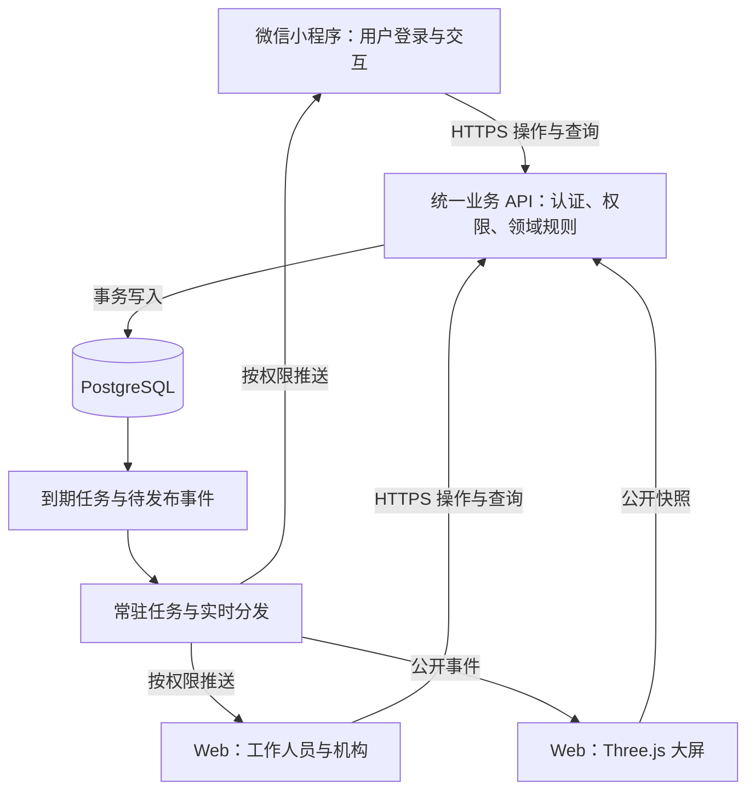

# 遇见－缘分实验室 V1.0：微信小程序与三端实时服务整改计划

- 状态：待用户确认，未实施。
- 日期：2026-10-10。
- 实际项目：`/Users/lvyong198201/Desktop/Game 2026/DestinyLab-MVP`。
- 已确认条件：用户已有小程序主体；预计约 500 人同时在线。
- 待核实条件：AppID 与开发成员配置、主体具体类型和适用服务类目、现有云资源与域名、现场网络和大屏设备、活动场次与数据留存要求。密钥不得通过聊天、普通文档或源码提交。
- 本次工作：读取实际代码与项目文档、核实官方接入说明、编写整改计划；未修改业务代码、测试、依赖或运行配置，未接入生产数据。
- 边界：此目录与兄弟目录“缘分实验室2026”是不同工程，不沿用后者的数据库、登录状态、验收结论或部署配置。本项目原有 Mock/视觉计划的批准不等于本计划批准。

## 1. 结论与建设目标

当前是 Next.js + React 的本地 Web Mock 产品，用于验证手机旅程、工作人员页面和大屏效果。尚未建成微信小程序、微信登录、业务数据库、服务端权限或跨设备实时服务。

手机、管理页和业务大屏共享的是同一浏览器、同一来源下的本地快照。不同手机、工作人员电脑、大屏电脑不会因此共享数据；同一电脑不同浏览器、用户配置或端口也不应被当作同一个数据源。`/screen/demo` 另有独立内存演示数据，更不能用于证明业务联通。

目标是：用户扫码进入微信小程序并登录，业务操作由统一服务端校验和持久化；工作人员查询其权限范围内的信息；大屏从相同业务事实取得公开数据。各端保持统一统计口径，但取得的个人字段因权限而不同。

## 2. 已核实的问题与影响

| 优先级 | 当前证据 | 正式使用时的问题 | 整改要求 |
|---|---|---|---|
| P0 | `src/lib/demo/store.ts:81–106` 读取和整体写入 localStorage，并通过 BroadcastChannel 通知 | 无业务数据库；跨设备不能共享；浏览器数据不具备统一持久化与备份保证 | PostgreSQL 保存权威业务数据；客户端只保留必要缓存和未提交草稿 |
| P0 | `src/lib/api/contract.ts:1–6` 仅定义返回完整 DemoState 的接口；未发现 `src/app` 内 API 路由 | 当前没有真实请求链路，不能直接把整个状态作为生产接口 | 建立正式 HTTP API、角色专属响应和统一错误/版本协议 |
| P0 | `src/lib/demo/hooks.ts:32–44` 从 URL 接受 actor；`store.ts:152–162` 在 sessionStorage 保存身份 | 用户可在本地选择模拟身份，没有微信账号绑定与可信登录态 | 服务端验证微信登录凭证；从会话确定用户，忽略客户端自报 actor/openid |
| P0 | `src/features/admin/AdminApp.tsx:61` 使用 `useAction("operator")`；领域函数按字符串判断运营身份 | 页面入口和前端判断不构成管理权限，尚无真正工作人员账号系统 | 工作人员登录、角色/活动/机构范围控制、审计与会话失效 |
| P0 | `store.ts:165–196` 使用浏览器锁并调用本地领域函数 | 浏览器串行化不能处理 500 个不同设备对同一邀请或点位的争用 | 数据库事务、行级锁、唯一约束、幂等命令和冲突反馈 |
| P0 | `hooks.ts:47–55` 由可见页面每 15 秒发起 sweep；`selectors.ts` 使用客户端时间 | 页面挂起或关闭后，过期和提醒没有持续可靠的执行主体 | 服务端时间；数据库记录到期时间；可恢复的常驻任务执行器 |
| P0 | `docs/DATA_MODEL.md:33,45,152` 明确完整状态是本地 Mock；大屏没有服务端推送 | 数据隔离目前只在前端展示层，不能把私密资料随完整快照推给各端 | 服务端分别生成本人、运营、机构和大屏的受控数据 |
| P1 | `WorldStage.tsx:31–33` 默认二维码为 localhost 手机网页地址 | 用户真机扫码不能进入正式小程序和正确活动 | 活动小程序码；携带无敏感信息的活动入口标识，服务端校验有效性 |
| P1 | Next 路由、DOM、localStorage、Web Locks、BroadcastChannel 广泛参与手机流程 | 现有 Web 页面不能直接打包成原生小程序 | 单独建立小程序端并适配路由、组件、生命周期、存储和登录 |
| P1 | `docs/DATA_MODEL.md:26,181` 表明业务尚无公开配对许可来源，默认不展示具体 Pair | 开发演示有配对动画不代表真实业务已授权展示 | 建立独立大屏展示许可及撤回链路；缺少许可保持匿名聚合 |
| P1 | 当前演示种子、整份数组选择器与本地测试服务于 Mock | 演示人数、见面次数与本机视觉测试不能证明真实容量或统计 | 正式空库起步；测试种子隔离；真实接口、并发、真机和现场验收 |

这是从已批准的本地原型走向正式服务的能力缺口，不意味着现有界面和领域规则需要全部推翻。

## 3. 建议架构与复用范围

建议选型：

- 用户端：Taro + React 小程序。先验证登录、基础页面、包体和真机兼容，再迁移完整十页旅程。Taro 支持 React，但组件、路由、平台 API 仍需适配；不把现有 Next 页面或当前 React 版本直接照搬进小程序。
- 运营/机构端：保留现有 Next.js 页面与交互，替换 Mock 数据和权限入口，补充服务端检索、分页、活动筛选。
- 大屏：保留现有 Three.js 场景、动画及降级能力，替换数据来源；统计不得由动画次数、页面访问或重复事件累加。
- 服务端：Node.js + TypeScript 的模块化业务服务。API、实时分发与常驻任务明确职责，第一版保持可维护的整体，不提前拆分大量微服务。
- 数据库：建议 PostgreSQL，使用事务、唯一约束、外键和索引维护业务一致性。此为下一步建议，当前工程未使用 PostgreSQL。禁止将整个 DemoState 作为单行 JSON 数据库直接部署。
- 部署：选择支持长连接、常驻任务、健康检查和日志的容器或服务器，数据库优先托管。云厂商、资源规格及购买范围待现有资源确认后确定。采用普通网络接口时准备 HTTPS/WSS 域名与有效证书；若选微信云托管，按其官方调用方式单独核实。
- Redis 不作为首版必需依赖；需要多实例实时分发、共享限流等能力时再依据部署与压测证据加入。PostgreSQL 始终保存业务事实。

可复用：产品旅程、题目与规则、虚拟头像、视觉资产、状态机语义、纯校验函数、统计定义、测试场景。必须迁移：身份判断、权限、交易状态推进、计时、资源分配、推荐读取权限和持久化。需替换：Mock store、URL 身份、全量 DemoState 网络合同和本机二维码。

## 4. 微信登录与授权

建议流程：扫码获取活动入口 → 展示活动介绍与必要的隐私说明 → 用户选择微信登录 → `wx.login` 获取临时 code → 后端调用 `code2Session` → 使用可信 `(appid, openid)` 关联内部用户 → 签发业务会话 → 加载其当前活动进度。

- 同一个微信用户再次进入恢复原用户和本场进度，不因刷新、换手机或重新登录重复创建参与记录。
- AppSecret、session_key 只存在受保护的服务端环境；session_key 不作为业务令牌下发。UnionID 按实际返回情况处理，不作为必须存在的主键。
- 正式写入答题、资料和邀请前必须有有效会话；客户端仅提交业务参数，服务端确定本人身份和允许操作范围。
- 微信登录只建立身份；活动昵称/头像、手机号、同舟资料共享、大屏展示及订阅通知按各自目的处理。保留现有活动昵称和系统虚拟头像，可减少对微信个人资料的依赖。
- 同舟资料授权不得替代大屏公开许可。缺少配对双方的有效公开许可，不展示可识别的具体配对；允许按约定展示匿名汇总。
- 手机号等可选服务资料不因登录而自动取得；拒绝可选服务授权不阻断基础活动流程。
- 微信身份不等于实名、年龄核验或现场签到。必须单独定义“加入活动”“在场”“当前在线”的含义，不将连接断开直接判为离场。
- 工作人员与普通用户是独立权限体系；已有工作人员账号要求在实施时通过受保护配置初始化，密码存哈希，不落明文源码、计划或普通日志。正式运营建议个人账号，以便追责和撤销权限。

## 5. 数据模型、事务与统计

拟建立的数据组：

| 数据组 | 主要内容 |
|---|---|
| 身份与权限 | User、WechatIdentity、Session、StaffUser、Role/Scope |
| 活动与参与 | Activity、ActivitySession（场次）、Participant、QuestionVersion、Answer |
| 相遇流程 | Invitation/Encounter、ParticipantTaskLock、各方出发/到达/确认、MeetPoint/Occupancy、Help |
| 授权服务 | Consent（目的、版本、时间、撤回）、AgencySubmission、允许的联系方式读取审计 |
| 可靠执行 | IdempotencyCommand、AuditEvent、OutboxEvent、ScheduledJob |

关键约束：

1. 用户身份唯一；同一用户在同一场次最多一个有效参与记录。所有业务读写、统计、事件订阅均受活动/场次范围限制。
2. 一个人不能同时占用多条有效相遇任务。用参与者任务占用表及唯一约束表达，不能仅分别限制邀请的 from/to 两列。事务锁按固定顺序取得，冲突返回明确业务结果。
3. 点位分配与占用检查在同一事务完成；确认见面和清理物理占用是不同事实，不因清点位抹掉历史见面。
4. 双方独立确认后才写入一次 realMeetAt；单方确认、工作人员操作、网络重试或大屏播放不得增计相遇。
5. 写操作带幂等 ID；同一 ID 与不同内容不能被静默当作相同成功。响应丢失后可查询/重试并恢复，不重复产生邀请、确认或提交。
6. 到期时间以服务端记录为准。客户端倒计时只是显示；请求处理也检查到期状态，常驻任务停机后可按数据库恢复处理。
7. 同舟资料继续与活动问答分开。撤回立即使机构访问失效；删除和过期异步请求不能恢复已删除资料；数据库备份与留存按确认后的策略处理。
8. “累计进入次数、去重参与人数、在线人数、在场人数、首题作答人数、完成全部问题人数、双向意愿对数、真实见面对数”逐项定义单位与去重规则。三端使用同一后端事实和版本；不能各自另算一套。

生产数据从空业务库开始；虚构种子只用于隔离测试环境。现存浏览器资料不默认导入真实库，若将来需要导入必须另做来源、授权、去重及迁移方案。

## 6. 实时服务与各端读取边界

操作处理顺序：认证与校验 → 数据库事务提交业务状态和 Outbox 事件 → 返回已提交结果 → 分发器向有权限的订阅者通知 → 各端应用新版本或重取快照。

- 提交成功代表业务已经持久化。推送失败不撤销已成功操作；Outbox 可重试，客户端可依据版本恢复。
- 小程序、运营页、大屏可统一用 WebSocket 通知；建立连接和订阅活动都必须鉴权。大屏即使公开访问，也只能得到公开投影；控制接口不能使用公开权限。
- 本人响应只含本人进度与允许查看的推荐/相遇信息；运营响应按角色返回必要业务字段；机构只能查有效授权资料；大屏不得取得手机号、微信标识、完整问答、私密选择或原始整库状态。
- 每份快照包含服务端时间和版本；事件有 ID、所属场次及顺序标识。客户端去重，拒绝旧响应覆盖新状态。
- 连接恢复从有效游标补齐，游标失效则重取当前快照；新快照建立一致基线。采用可证明不会在快照与订阅间漏事件的协议。
- 页面回到前台必须重新核验会话和状态。小程序后台连接/请求不能作为可靠定时器；需要离线提醒时另行申请并验证订阅通知能力。
- 断连显示连接状态与数据更新时间；不自动补虚构数据或将未知值展示成真实零。降级轮询限制频率和抖动，避免 500 端同时重连冲击服务。
- 姓名/头像及配对许可撤回后，删除现有公开视图和动画队列中相应内容。断网大屏无法即时收到撤回，须采用有时效的公开展示许可；许可到期停止可识别展示，恢复后重新获取授权数据。
- 统计快照恢复到最新事实，断网期间的历史动画按时效丢弃，不重播成新的现场相遇。历史播放不会写回计数。

## 7. 分阶段实施与拟修改模块

实施前先记录当前工作区基线；已有大量未提交的视觉与文档变更，不覆盖、回退或混入其他任务的改动。涉及 Next.js 修改前阅读本工程安装版本的对应指南；小程序依赖独立验证兼容版本。

| 阶段 | 交付及主要模块 | 阶段验收 |
|---|---|---|
| 1：冻结契约与最小工程 | 更新 PRD/旅程/数据模型/验收；新增 `miniapp/`、`server/`、`db/`；按需要建立共享 contracts/domain 模块。定义鉴权、字段、事件、状态和统计口径 | 接口/权限/数据字典可审阅；选型与目录不破坏原 Web 演示 |
| 2：先打通真实闭环 | 小程序扫码与微信登录、参与者与回答入库；工作人员登录和检索；大屏公开聚合接口及实时更新；使用独立测试库 | 两部真实手机各自登录答题，工作人员电脑查询，大屏电脑同时更新；重启后记录保留 |
| 3：完整业务迁移 | 将 `src/domain/commands.ts` 的业务语义迁到服务端；补邀请并发、点位分配、双方确认、到期任务；迁移完整小程序旅程与同舟授权 | 重复提交、争抢同一人/点位、过期、撤回及私密选择均符合规则 |
| 4：三端接入与可靠性 | 将 `src/lib/api/contract.ts` 拆为真实契约，替换 admin/agency/screen 数据源；接入公开许可；完成断线补偿、失效会话和前后台恢复 | 角色越权无效；只显示允许字段；断网重连不漏状态、不重复计数、不泄漏撤回资料 |
| 5：500 人验收与发布准备 | 并发与故障测试、开发者工具和真机验证、现场网络与大屏验证、备份恢复、告警、版本兼容、部署/提审材料 | 形成明确测试证据与未通过项；另经用户确认才执行资源购买、正式部署及提审发布 |

阶段 2 优先形成可验收闭环，避免等所有页面迁移完成才发现微信、数据库和实时链路不通。阶段 3、4 可按每个完整业务流程逐项接入，不能长期一半写本地、一半写真库形成双重权威。

同步维护：`docs/PRD.md`、`USER_JOURNEY.md`、`DATA_MODEL.md`、`ACCEPTANCE.md`、`MINI_PROGRAM_ROADMAP.md`、`CHANGELOG.md` 与必要的设计/部署说明。通过后将本计划补充证据并移至 `plans/archive/`，不得提前标完成。

## 8. 验收目标与方法

以下是建议验收目标，当前尚未通过，也不是现有工程的容量承诺。500 人在线不是 500 次请求/秒；需要同时验证连接数量和实际业务负载。

- 容量基线：500 个独立已认证在线用户，加实际数量的运营端和大屏；测试 500 人在 10 秒内集中提交一道题（约 50 次业务提交/秒），并叠加邀请/查询与连接恢复。具体负载按活动节奏确认；使用测试身份压测自有业务 API，不通过批量真实微信登录制造平台负载。
- 正常服务与约定网络条件下，业务提交至运营/大屏可见的端到端延迟建议 p95 ≤ 2 秒；业务 API 响应建议 p95 ≤ 1 秒（不含微信外部登录换码）。必须记录测量起止、样本、异常和部署规格。
- 连续 2 小时混合业务测试，并演练一次活动完整时长；记录错误率、数据库连接/锁等待、任务积压、推送延迟、客户端内存及现场大屏帧率。压测和短期本机动画测试不能代替现场验收。
- 一致性：同一邀请双端同时确认、相同命令多次重放，只产生一次真实见面；同一用户和点位不会双占；业务事实与三端允许展示的统计一致。
- 持久化：提交后刷新、重新登录和服务重启不丢数据；到期任务恢复；推送分发器停机恢复后最终可见；备份能在隔离环境实际恢复。
- 断网：用户提交后丢响应、全部或部分连接短时断开、恢复时旧请求晚到，均不重复提交或恢复旧状态；网络未恢复前不承诺实时性。
- 权限：普通用户不能改 actor 冒充他人；未授权管理访问被拒；跨活动和跨机构访问被拒；大屏接口/消息中无私密字段；撤回后在线端移除，离线端按许可时效隐藏。
- 小程序真机：至少覆盖 iOS、Android，扫码进入指定场次、重复进入恢复进度、前后台切换、会话过期、拒绝可选授权、资料提交/撤回/删除，以及两人完整相遇旅程。
- 发布隔离：正式环境无演示身份切换、场景重置接口和虚构人数；`/screen/demo` 等开发演示不会成为现场默认入口；生产故障不得回退填充种子数据。
- 版本兼容：小程序发布有审核与客户端更新差异，后端保留至少上一已发布版本的兼容契约；发布前演练旧小程序连接新后端，必要时明确提示升级。

## 9. 主要风险与回退

- 平台准入：用户已拥有主体，但不自动表示当前交友/婚恋功能符合已开通类目。实施初期核对主体类型、实际功能和管理后台能力，按当时官方材料确认，不能先承诺必然通过审核。
- 隐私与运营范围：明确工作人员可查询哪些资料；基础活动与机构线下服务分开授权。应把授权文案与实际接口字段逐项核对。
- 兼容风险：Taro 与现有 Next/React/浏览器能力不同，阶段 2 先做真机技术闭环，版本确认后再扩展。
- 现场风险：500 人现场网络和大屏硬件可能成为瓶颈；在实际网络演练，记录大屏离线行为、故障联络和恢复步骤。
- 回退：开发期间保留原 Mock 演示入口与视觉基线，但正式环境不得从真实服务静默切回 Mock。服务故障暂停新操作并给出状态，保留已提交数据。
- 数据迁移采用可兼容的增量方式。发布回退优先回退应用且保留数据库；破坏性回滚或从备份覆盖数据必须另行审批，不能在真实活动写入后自动执行。
- 本计划批准范围为开发、文档和约定的隔离验证；资源购买、外部正式部署、微信提审/发布不因确认开发计划而自动获准。

## 10. 本轮参考与待确认决定

代码与文档已在本项目现场读取；本轮未重跑构建/测试、未验证真实微信登录或进行 500 人压测，不能作为生产验收报告。

官方参考（2026-10-10 查阅）：

- 微信小程序登录：https://developers.weixin.qq.com/miniprogram/dev/framework/open-ability/login.html
- 微信小程序网络：https://developers.weixin.qq.com/miniprogram/dev/framework/ability/network.html
- Taro React 开发差异：https://docs.taro.zone/docs/react-overall
- PostgreSQL 数据约束：https://www.postgresql.org/docs/current/ddl-constraints.html

微信登录及网络页面已直接读取官方网页；Taro 依据官方文档搜索结果核对，其页面直读曾超时；实施时仍须结合选定版本文档复核。技术选型、延迟和负载数值属于本项目建议，非官方性能保证。

请用户确认：是否按“React 小程序端 + 保留 Web 运营/大屏 + 统一 TypeScript 服务端 + PostgreSQL，先验证真实闭环，再完成全流程，按 500 人在线验收”的范围开始实施。确认前保持只读调查与计划文档工作。
