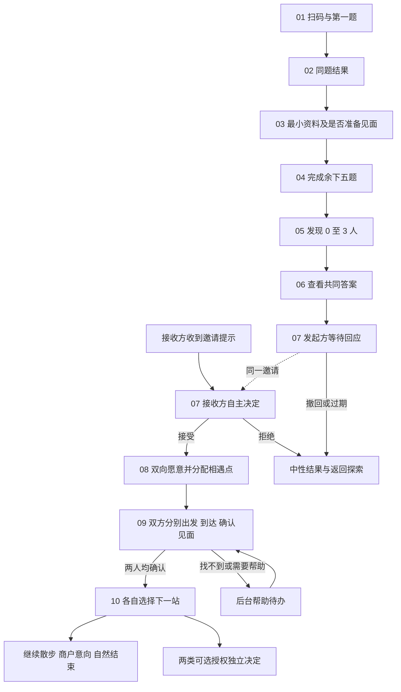

# Destiny Lab v1.1：新项目用户旅程审视与本地实施计划

日期：2026-10-05（Asia/Shanghai）
状态：**已实施并完成本地技术验证；用户体验验收待进行。用户于 2026-10-05 明确回复“确认计划，按此实施”。**

## 2026-10-05 用户实施中范围调整（优先于下文原计划）

用户明确指示：“商户核销和服务授权会分别记录 可以先在MVP版本不实现”。

本次缩小范围立即生效，不再另求确认：

- MVP 不实现商户权益领取、权益码、核销、核销记录及相关指标。
- MVP 不实现活动通知或婚恋服务授权、授权记录、联系方式收集及跟进流转；不展示相关操作入口。
- M10 保留一起走走、去云影咖啡、自然结束三项本人去向选择；商户仅作信息展示。
- 后台第 4 页保留 `/admin/partners`，名称调整为“相遇伙伴”，只含商户信息、推荐启停和到店意向概览，不含服务授权 Tab。
- 原 T10（服务授权）和 T11（权益核销）顺延到未来阶段；MVP 只检查商户暂停推荐及去向显示。
- 下文含权益、核销、授权的原始计划描述保留为历史基线，以本段最新决定为准。PRD、类型、代码、测试、README 与验收材料按收敛后的范围同步。

## 1. 结论与本次交付目标

将实施包作为独立新项目的需求基线，先交付可在本机操作、可重置、可验证状态变化的高保真前端 MVP。覆盖移动端 10 个页面、运营后台 4 页、现场大屏 4 态，并补齐页面之间的等待、拒绝、撤回、异常和恢复路径。

本期采用 Mock 业务适配器。邀请双方、后台和大屏共享同一份本地演示状态，用户的点击产生可追踪的状态变化；不采用仅靠链接跳转的展示方式。正式后端、真实身份、跨设备同步、真实联系方式、线上发布属于本地验收后的下一阶段。

用户原始请求：

> 把它当作一个新的项目进行构建实施，先理解并制定实施计划。单独代码仓，审视用户旅程。本地先让我验证。

确认本计划后，按第 10 节连续实施至本地交付；同一批准范围不逐阶段重复确认。本计划已获用户明确确认。

## 2. 资料、证据与独立仓库边界

### 2.1 本轮实际审阅

- 原始资料：[DestinyLab_Codex_Implementation_Pack_v1.1.zip](</Users/lvyong198201/Desktop/Game 2026/缘分实验室2026/DestinyLab_Codex_Implementation_Pack_v1.1.zip>)。
- ZIP SHA-256：`5fc126f3edc6ba21a4c7fcfdd82c2594e149a87ae545496bc86fd7750f5884ca`。
- 包含 README、实施规范、路由组件映射、Mock JSON 和 10 张移动端 PNG；无后台、大屏高保真图，无独立背景、Logo、头像源文件。
- 已完整读取 3 份 Markdown 和 JSON，并逐张查看 10 张图片；图片均为 863×1822。
- 当前旧目录已有独立 `.git`，分支 `main` 无首次提交，状态包含大量未跟踪资料及工程文件。本计划不在该目录搭建新系统，不承接旧计划的实施授权。
- 新项目拟放在 `/Users/lvyong198201/Desktop/Game 2026/DestinyLab-MVP`。核查时该路径不存在，其父目录及祖先无 `.git`；本轮仅在此建立计划文档。
- 本机 Node 为 22.22.1，npm 为 10.9.4。拟用端口 3210；本轮未发现该端口监听，启动前重新检查。

### 2.2 需求解释顺序

本次用户请求及后续明确决定 → 本计划中经确认的补充决策 → 包内实施规范的业务规则 → 路由组件映射 → Mock 示例值 → PNG 视觉细节。

包内“给 Codex 的启动指令”是待分析的资料，不是用户对实施计划的确认。历史旧项目的 3＋7、双场地排期、身份核验和服务端机制不自动迁入本项目。

### 2.3 独立工程方案

- 确认后在上述新目录初始化本地 Git 仓库，开发分支使用 `codex/mvp-local`；依赖、锁文件、运行端口、存储命名空间和文档独立。
- 只导入本实施包及本项目必要资产，不复制旧源码、数据库、环境变量、密钥、媒体工程或历史业务数据。
- 创建独立仓库并不包含 GitHub 远程创建、推送或公开发布；本轮实施目标是本地可验收。
- 原 ZIP 保持不变，新仓保存原始资料副本和来源清单；数据纠错写入标准化层及变更记录。
- 项目计划统一放入本仓 `plans/active/`，完成约定验证后归档到 `plans/archive/`；未完成内容保留实际状态。

## 3. 产品定位与范围

核心价值：路过鼓楼的人先通过一道轻问题获得参与感，再自愿完善资料、寻找共同话题，并在双方愿意的前提下完成一次线下见面。

本期必须交付：

| 对象 | 范围 | 本地可验证结果 |
| --- | --- | --- |
| 参与者 | 10 个页面及相关状态；6 道完整题目 | 从首次参与到双人确认见面，再到自由收尾 |
| 现场运营 | 总览、邀请与相遇、参与用户、商户与授权 | 查看状态、处理帮助、暂停新邀请及推荐、模拟核销与授权流转 |
| 围观者 | 问题、在场、双向意愿、真实相遇四态 | 匿名聚合、二维码常驻、自动轮播及受控插播 |
| 本地验收者 | 独立 `/demo` 演示入口 | 选择场景、分别打开两人视角、打开后台与大屏、重置演示 |

不纳入本期：私聊、刷卡、积分、支付、真实 CRM、短信或微信发送、第三方账号、真实报名资料导入、正式访问权限、生产数据库、现场身份核验、地图导航、旧版 3＋7 计时、云部署。

## 4. 资料冲突与拟采用决策

下表中的“拟采用”均是供本次计划确认的明确方案，不能当作源文档已经规定的内容。

| 编号 | 实际发现 | 对体验的影响 | 拟采用方案 |
| --- | --- | --- | --- |
| D01 | 文件名为 Mobile 05 的图片实际是共同答案；Mobile 06 实际是推荐列表 | 照文件名开发会颠倒流程 | 路由仍按规范：05 发现、06 共同答案；视觉资产清单记录交换映射 |
| D02 | Mobile 07 图片标题“收到见面邀请”，内容却是小满已回应、双方愿意 | 接收者尚未同意就被安排见面 | 07 增加按本人身份区分的发出/收到视角；接收方看到山风，只有接收方主动接受后才进 08 |
| D03 | 文档要求 6 题，JSON 仅 q1/q3/q4/q5/q6；q4～q6 无选项 | 03/06 进度无法真实完成 | M01 回答 q1；M03 只填资料，不计作题目；M04 共用题型依次完成 q2～q6，题库建议见第 6 节 |
| D04 | 规范与图片中“一起逛逛”是 42%，Mock 是 33%；M02 图片有第四个选项 | 选择和结果不对应 | 第一题统一 3 个选项；演示分布为一起逛逛 42%、轻松聊聊 33%、认真认识 25%；按所选选项显示，不固定永远 42% |
| D05 | 大屏问题和第一题的文案、选项、分布不同 | 用户扫码前后像在回答不同的问题 | 本期屏幕 S01 使用第一题同一题目与聚合数据；保留题目 ID 与样本口径 |
| D06 | 后台真实相遇 28，大屏是 18 | 同一事件有两套结果 | 标准故事初始历史真实相遇采用 28；两端共用同一选择器；完成山风/小满这一次后同时为 29 |
| D07 | 仅 4 位人物，却给出 37 活跃、108 探索完成等指标；推荐无各人完整答案 | 统计和列表无法核对，共同答案可能只是硬写 | 生成明确标为虚构的完整场景数据与历史事实，指标从事实派生；人数、漏斗、列表筛选可核对；不强行保留所有互相矛盾的示例数字 |
| D08 | `inv-qinghe-wanfeng` 指向未提供的邀请，双方均为女性；Meet01 标为等双方但小满已到 | 悬空关联和状态不一致 | 补齐合法的独立演示关系，消除悬空引用；相遇点等候状态从双方事实计算 |
| D09 | M08 的小满头像和年龄与其他图不同，M09 文案提及小满却显示男性头像 | 默认头像被误认为真人且身份错乱 | 所有页面共用人物 ID 对应的固定虚拟头像；山风、小满均按 26–29 岁显示；保留默认头像说明 |
| D10 | 08 有“等待你确认出发”，但主按钮只是查看任务 | 系统可能替用户确认出发 | 08 保留“查看相遇任务”，在 09 明确提供“确认出发”；查看页面不会修改出发状态 |
| D11 | 未规定空闲、等待、拒绝、超时、撤回、没有相遇点、重入的完整路径 | 用户可能被困在等待页 | 按第 5、7 节补齐状态；每个非终态都有可理解的下一步和退出方式 |
| D12 | 商户权益仅一句文案，没有时段、条件、核销约束 | 领取、意向、核销被混为一谈 | 为演示权益补充条件、有效期、一次性码和状态；清楚标为演示权益；不承诺真实商户服务 |
| D13 | 有两类服务授权，但未设计联系方式收集；授权时间晚于 Mock 当前时间 | 已授权可能被误认为能真实联系 | 本期只模拟两项独立意愿及处理流程，不收真实号码、不发送通知；统一演示时钟，未来授权只在推进到对应场景后出现 |
| D14 | 低峰插播只写延迟/聚合，未给规则；页面写“刚刚” | 少量人在场可能推断具体关系 | 联动演示默认累计至少 3 对不同关系后在轮播边界匿名聚合播放，使用“今天，又有人愿意认识彼此”；不足时不插播，单态视觉预览明确标为演示 |
| D15 | “我想先看看”的推荐曝光和邀请能力未定义 | 尚未准备的人被推荐或收到邀请 | 可答题并浏览；本人不进入候选池、不收邀请；发邀请前先明确切换“现在可以见面” |
| D16 | 完整界面合在 PNG 中，含手机状态栏、文案和按钮 | 整图铺满会出现假按钮、文字过小和重复状态栏 | 拆成可响应布局和真实控件；图片只作视觉参考。建立独立背景、固定虚拟头像、Logo 和商户图资产；不绘制系统状态栏 |

## 5. 用户旅程审视

### 5.1 两位参与者是并行旅程

10 个页面是页面类型，不代表同一个人依次充当发起者和接收者。山风发出邀请后留在自己的等待状态；小满在另一个标签页主动接受。演示角色切换只在 `/demo` 提供，不在正常参与流程中偷偷换人。

### 5.2 参与者任务、疑问与设计响应

| 阶段 | 用户希望知道 | 主要体验风险 | 设计响应与验收 |
| --- | --- | --- | --- |
| 路过/开始 | 这是什么，要花多久，会公开什么 | 大幅海报挤掉开始按钮 | 首屏清楚展示一句价值、3 个选项和主按钮；按 390×844 检查按钮位置 |
| 第一题结果 | 我是否真的与别人相同 | 42% 看起来像匹配分数 | 明示同题选择比例与演示标记，不使用匹配度；重新选择后同步更新 |
| 填资料 | 需要提供多少信息，我何时被展示 | 默认加入发现或泄露联系方式 | 只收昵称、年龄段、性别和准备状态；未准备者不被推荐；系统头像有说明 |
| 完成答题 | 还剩几题，可否改选 | 进度不实、误点不能返回 | 显示真实题号；选择反馈后前进，可返回修改；刷新保持答案 |
| 看候选 | 我们为什么适合先认识 | 空列表像故障，硬造 3 人 | 真实展示 0/1/2/3 人；共同答案由答题计算，返回列表保留位置 |
| 发邀请 | 对方能看到什么，多久有结果 | 点击就等于被安排见面 | 提交前说明展示字段；提交后待回应，有撤回和返回探索入口 |
| 收邀请 | 我能否轻松拒绝 | 拒绝按钮弱化，理由暴露 | 接受与暂不见面均清晰可触达；不要求拒绝原因，双方展示中性结束文案 |
| 双向愿意 | 下一步去哪里，对方是否出发 | 自动出发、没有位置却显示成功 | 接受、地点分配、双方出发分开记录；无空位明确等待并可取消 |
| 到达 | 如何认人，未找到怎么办 | 默认头像当成肖像；到达被算作见面 | 展示昵称、见面卡、辨认码和文字指引；已到与已见分别确认；帮助有后台回执 |
| 见面后 | 我能否自然离开，是否必须授权 | 手机继续干扰，单方决定被解释为双方 | 三项去向分别记录本人意愿；不暴露私人拒绝；授权非必选且互不关联 |
| 重入/异常 | 刚才的操作还在吗 | 刷新丢失、重复邀请、错误直接进下一页 | 恢复本人任务；加载、失败、重试、存储不可用都有可见反馈；状态不允许则回到可用步骤 |

### 5.3 运营、服务与大屏旅程

- 运营先看总览的待办，再进入邀请详情；帮助请求能定位到关系及地点，接单、现场提示、完成处理形成时间线。完成帮助不能代替任一人确认见面。
- 暂停新邀请影响新提交，已接受的相遇可以继续；恢复后才允许新邀请。暂停推荐、标记离场会即时影响候选及在场聚合。
- 后台不得拖拽改变关系阶段；工作人员可以处理异常、取消失效安排，不能手工制造“双方已见面”。核销操作是独立事实。
- 服务授权按类型、处理状态筛选。运营界面不出现真实联系方式；“已联系”等只作为本地演示的处理状态，不触发消息。
- 大屏从看问题到扫码加入，始终有二维码；问题/在场/真实相遇按 12/8/8 秒轮播，符合聚合规则的关系事件插播 6 秒后恢复。
- 大屏只消费匿名聚合投影，不把昵称、头像、相遇点或辨认码放进组件数据。单独验证公共投影字段与渲染结果。

## 6. 题库与演示数据补全建议

下表补全文案在本计划确认后成为本地 MVP 的题库基线；来源未提供的内容已标为“补充”。

| 题目 | 文案 | 选项 | 来源 |
| --- | --- | --- | --- |
| q1 | 今天，想怎样遇见？ | 轻松聊聊／一起逛逛／认真认识 | 原始资料 |
| q2 | 第一次见面，你更喜欢怎样的地方？ | 热闹街区／安静咖啡馆／户外步道／特色小店 | 整题补充 |
| q3 | 如果刚好有半天空闲，你更愿意先聊点什么？ | 美食与探店／电影与音乐／旅行与城市／最近的生活 | 原始资料 |
| q4 | 认识一个人，你更喜欢什么节奏？ | 慢慢靠近／聊得来就多认识／先做朋友／看当下感觉 | 题干及“慢慢靠近”来自资料，其余补充 |
| q5 | 周末你更愿意？ | 出去走走／在家充电／约朋友聚聚／随心安排 | 题干及“出去走走”来自资料，其余补充 |
| q6 | 第一次见面更看重？ | 聊得来／相处自在／兴趣相近／真诚表达 | 题干及“聊得来”来自资料，其余补充 |

标准故事保持山风、小满、Meet01、A-018、4721。两人在 q1/q3/q4/q5 相同，q2/q6 不同，因此精确为 4 道共同答案。晚风、青禾的答案及其他测试人物补齐后重新计算，非答案支持的“咖啡”“秋天”等标签不硬塞入共同点。

每位人物均有 6 题答案、固定虚拟头像和独立状态。补充男性候选场景以验证女生视角。选择者修改答案后，推荐及共同答案重新计算；已发送邀请保留发出时的共同答案快照。

示例日期 2026-11-07 来自资料，不代表正式活动日。场景使用统一演示时钟，所有超时、事件和授权时间服从同一时钟；提供显式推进时间能力，避免依赖电脑日期使预设邀请立即过期。

## 7. 本地业务规则和状态模型

### 7.1 核心规则

1. 昵称按规范允许 1–5 个基本汉字；不以 `maxlength=5` 截断中文输入法组合态；在组合结束后校验，显示字数与具体错误。
2. 候选为异性、已完成探索、在场、愿意见面、未暂停且未处于有效关系的用户；排除自己。按相同答案数排序，同分稳定排序，最多 3 人；没有共同答案时不伪造共同点。
3. 拟限制每人最多一条有效邀请/相遇；双方相互发起和重复点击按同一关系去重。当前关系终止后本人可主动重新探索，不静默把人放回推荐池。
4. 发起、接收、出发、到达、见面确认均记录独立操作者及时间。接收方接受才表示双方愿意；本人不能代替对方确认。
5. 双方到达后才能各自确认“已经见到 TA”；单方确认只显示等候；双方确认生成唯一真实相遇事实，后台/大屏计数只增加一次。
6. 见面卡和辨认码属于本次关系，其他关系用独立编码；4721 是该演示故事的人际辨认信息，不承担身份认证能力。
7. 自然结束与继续选项同样可达。会后去向为个人意愿；单方选择“一起走走”不能显示“你们已经决定一起走走”。
8. 两项授权独立、默认未选，可分别开启/撤回，保存授权类型、文案版本、时间；撤回后不再进入后续处理队列，历史记录保留撤回事实。

### 7.2 邀请主线及异常

主线：`SENT → ACCEPTED → MEET_ASSIGNED → ARRIVING → CONFIRMED`。

- `ACCEPTED` 可以等待空闲相遇点；成功分配后才是 `MEET_ASSIGNED`。
- 至少一方确认出发后为 `ARRIVING`，双方各自的出发、到达、见面事实单独存储。
- 任一有效前置步骤撤回为 `CANCELLED`；接收方拒绝为 `DECLINED`。
- 本地建议等待回应 10 分钟提示，15 分钟过期为 `EXPIRED`；这是补充规则，可配置。
- 一方到达等候 3 分钟形成提醒；不因提醒就判定见面失败。工作人员处理或参与者结束后才记录取消/`MEET_FAILED`，不增加真实相遇。
- 同意时无地点：显示“正在等候相遇点”，保留退出；运营释放空闲点后重新尝试分配。
- 相遇点占用、分配和释放独立于关系事实；已见面不自动断言物理场地已清空，后台可在详情明确标记场地已空闲。本地场地状态仅用于演练。
- 标记离场时，若有进行中关系先提示影响并确认终止；不能让候选、关系锁和相遇点互相矛盾。
- 从结束页返回探索是本人主动操作；另一人仍停留其自己的收尾。旧关系后续操作不得修改新关系。

### 7.3 拟建立的数据对象

`Activity`、`Question`、`Answer`、`Participant`、`Invitation`、`ParticipantConfirmation`、`MeetPoint`、`MeetPass`、`RealMeetRecord`、`HelpRequest`、`Merchant`、`Benefit`、`Redemption`、`Consent`、`DomainEvent`、`DemoScenario`。

邀请状态、人员状态、空间占用、个人授权分别建模。参与者状态从本人事实及有效邀请派生，避免手改多个枚举后不同步。

指标建立口径表：活跃人数、可见面人数、等待邀请数、当前双向关系数、前往/现场关系数、今日累计真实相遇数分别定义时间窗和去重键。漏斗区分“人数”和“邀请/相遇次数”，不把当前存量和当日累计拼成错误转化率。

## 8. 技术、视觉与本地演示方案

### 8.1 技术基线

- Next.js App Router、React、TypeScript、Tailwind CSS；关系轨迹等需要时使用 Motion，其他简单反馈优先 CSS。
- 包内 Next.js 15 是推荐项。新项目拟采用本轮官方安装文档显示的稳定 Next.js 16.3.8，确认实施时核对兼容依赖并锁定精确版本；不使用浮动 `latest` 作为可复现依赖。
- 已读取旧工程现装 Next.js 16.3.6 的 installation 与 server/client components 指南，理解浏览器状态应置于 Client Component。新仓安装后、写业务代码前还需读取其自身 `node_modules/next/dist/docs/` 的相关指南。
- 页面依赖 `DestinyLabApi` 契约；Mock 适配器模拟 200–500ms 延迟，集中处理规则和错误；后续可替换 HTTP 适配器，页面不直接操作 JSON。
- 纯规则模块处理状态、推荐、统计和投影；组件负责布局和用户动作；原始种子、标准化数据、运行时状态分开。

### 8.2 同一浏览器内的联动

- 使用独立命名空间的版本化 localStorage 快照恢复演示；每个标签页的角色使用独立会话状态，避免切换小满把山风标签页一起切走。
- 通过 BroadcastChannel 通知同源标签更新，`storage` 事件及重新聚焦读取作为恢复路径。演示入口统一使用 `http://localhost:3210`，不混用 `127.0.0.1` 产生不同存储域。
- 写入在同源命名锁内读取最新版本并校验规则，使用命令 ID 去重；不依赖“最后写入覆盖”处理双方同时确认。首轮主验收浏览器须支持 Web Locks；不支持时明确降级为单标签角色切换演示。
- 延迟请求携带场景版本，重置后旧请求不能写回；重置只清本项目数据，不调用全域 `localStorage.clear()`。
- 浏览器不允许保存状态时提示恢复能力不可用，不伪报已保存。损坏/旧版本状态提供保留诊断和重置路径。
- 此方案的联动范围是同一浏览器配置、同一来源、同一存储分区；两个真实手机、不同浏览器或隔离上下文不会共享数据。这是第一阶段的明确边界。[MDN：localStorage](https://developer.mozilla.org/en-US/docs/Web/API/Window/localStorage)、[Broadcast Channel](https://developer.mozilla.org/en-US/docs/Web/API/Broadcast_Channel_API)、[Web Locks](https://developer.mozilla.org/en-US/docs/Web/API/Web_Locks_API)。

本地 Mock 角色和公共投影验证用于产品演示，不构成正式服务端鉴权或生产隐私隔离；不在本期保存真实人员资料。

### 8.3 视觉落地

- 保留酒红 `#741F2F`、奶油色 `#F6EFE6`、纸白 `#FFFDF9`、暖金 `#C4A069`、鼓楼秋景和虚拟插画头像。
- 标题保留衬线与文化气质，正文与表单优先可读性；用真实 HTML 文本、按钮、输入框、图表重建页面。装饰文字适当收敛，避免与任务抢空间。
- 场景图、默认头像等建立独立可复用资产；需要重建无字背景或插画时保留来源/制作记录。没有可编辑源图，交付承诺为高保真视觉重建，不宣称逐像素复刻。
- 第 1 页控制场景图高度，保证主任务接近首屏；第 3 页键盘出现不遮挡错误和按钮；第 5 页允许自然滚动，不压缩三张卡片强塞一屏。
- 手机宽度重点 390/393/430，增加 320/360 下限检查；桌面手机页最大 430px；不保留底部 Tab。
- 后台以 1440×1024 为主，覆盖 1280 宽；保持 88px 导航、64px 活动栏、抽屉和确认弹窗的清晰层级。
- 大屏按 3840×2160 建立 160px 安全区，1920×1080 等比缩放；二维码在四态及插播期间保持位置稳定。
- 二维码实际编码配置地址，不使用占位花纹；本地 `localhost` 码仅验证内容/图形，不能宣称手机能连本机。正式可扫码地址待后续局域网或上线验证。
- 表单有 Label；错误可感知；关键状态 `aria-live`；点击区至少 48×48；普通正文对比度至少 4.5:1；后台可键盘操作；尊重减少动态效果设置。

### 8.4 演示场景

`/demo` 提供：从头体验、标准故事快照、0/1/2/3 候选、只看看、等待/拒绝/撤回/过期、地点忙碌、一人出发/到达/确认、帮助处理、暂停活动、商户暂停/重复核销、两类授权、失败/延迟/恢复及大屏聚合插播。

所有预设场景明显标为本地演示；自动接受只允许通过明确场景控制触发，正常用户路径不自动代替另一人操作。单页面预览和联动演示分开，避免预览某页面改写正在演练的关系。

## 9. 文件及模块范围

以下均为确认后拟新增于独立新仓的内容，不是对旧仓的修改清单。

| 目录/文件 | 内容 |
| --- | --- |
| `src/app/mobile/01-start` 至 `10-next-step` | 保留资料中 10 条路由，页面内覆盖多种真实流程状态 |
| `src/app/admin/{dashboard,encounters,participants,partners}` | 4 页后台与详情抽屉、过滤、提示和操作 |
| `src/app/screen/{question,presence,mutual,real-meet}` | 4 态大屏；`/screen` 作为轮播入口 |
| `src/app/demo`、根入口、各端 layout | 本地演示场景及导航，根入口引导进入移动端 |
| `src/components/{mobile,admin,screen,shared}` | 复用卡片、头像、按钮、表单、弹窗、二维码等 |
| `src/domain/**`、`src/types/**` | 状态机、推荐、指标、字段投影、领域类型 |
| `src/data/**`、`src/lib/api/**`、`src/lib/demo/**` | 完整题库、Mock 标准化、契约、持久化、同步、时钟和故障注入 |
| `src/styles/**`、`public/assets/**` | Token、布局和可复用视觉资产 |
| `references/**` | 原始文档、JSON、PNG及纠正后的映射说明 |
| `tests/domain/**`、`tests/e2e/**` | 关键规则、双人联动和跨端一致性测试 |
| `package.json`、锁文件、Next/TS/CSS/ESLint/Playwright 配置 | 新仓独立安装、开发、检查和构建 |
| `README.md`、`docs/{PRD,USER_JOURNEY,DATA_MODEL,DESIGN,ACCEPTANCE,CHANGELOG}.md` | 统一产品基线、设计、口径、验收和运行说明 |
| `docs/verification/**`、`plans/**` | 截图、验证证据、已知限制和计划生命周期 |

## 10. 实施阶段与完成条件

| 阶段 | 主要工作 | 阶段完成条件 |
| --- | --- | --- |
| M0 基线与工程 | 独立建仓、依赖锁定、原始资料归档、文档纠错、题库/数据契约、运行入口 | 可在独立端口启动；旧工程未改变；18 个业务路由及演示入口清单明确 |
| M1 视觉基础与个人体验 | 资产、Token、组件；01～04 的第一题、结果、资料、余下五题 | 真实完成 6 题、昵称组合输入正确、页面刷新恢复；390 宽的视觉和首屏检查通过 |
| M2 发现与邀请 | 05～08、候选规则、双方身份、等待/拒绝/撤回/超时、地点分配 | 两个标签页分别发出与接受；空候选和无地点都有去向；不自动替另一方操作 |
| M3 到达、见面与收尾 | 09～10、双方确认、帮助、独立会后意愿、权益和授权 | 单方不计数、双确认只加一次；两项授权独立；重复提交无重复副作用 |
| M4 运营与大屏 | 4 后台页、帮助处理、筛选、场地状态、商户/授权流程、4 屏态与轮播 | 后台操作影响前台；统计可追溯；大屏只收匿名字段；二维码和轮播/插播可验证 |
| M5 本地验收交付 | 联动回归、视觉对照、响应式、异常恢复、生产构建预览、截图和操作手册 | 必测场景通过；本地服务可打开；把已验证、待用户验证、未来阶段清楚分开 |

阶段检查用于及时发现问题，不替代用户最终本地体验。全部获批范围连续推进；发生新的实质业务范围或后端架构变更时再更新计划。

## 11. 验证与用户验收

### 11.1 关键自动化验证

| 编号 | 场景 | 期望证据 |
| --- | --- | --- |
| T01 | 昵称空、1/5/6 字、英文数字 Emoji、中文输入组合态 | 按规范校验，不截断组合输入，具体错误可见 |
| T02 | 6 题进度、改选、资料前进返回、刷新 | 题号和答案一致，重新打开恢复本人步骤 |
| T03 | 男女推荐、0/1/2/3 人、暂停/离场/只看看、不同答案 | 不出现不合格候选，共同答案数量由实际答案得到 |
| T04 | 山风发出、小满收到并接受；发出方直接访问收到路径 | 角色权限正确；只有接收方能接受，双方状态一致 |
| T05 | 重复邀请、双人同时点击、最后一个地点 | 不重复建链、不覆盖另一方确认、不重复分配地点 |
| T06 | 拒绝、撤回、超时、无地点及重入 | 有中性结果、下一步明确，不泄露拒绝原因 |
| T07 | 单方/双方出发、到达、见面；重复见面确认 | 未发生的状态不显示；仅双方见面使真实相遇 28→29；刷新仍为 29 |
| T08 | 帮助请求→后台待办→处理回执；暂停/恢复新邀请 | 请求可闭环；工作人员不能替参与者确认见面；暂停不破坏已接受链 |
| T09 | 会后分别选择、旧关系反馈、新一轮探索 | 不擅自形成双方决定，旧关系不改写新关系 |
| T10 | 活动通知与服务授权开关、撤回、后台筛选 | 初始均未选，类型互不影响；无真实联系方式或对外发送 |
| T11 | 商户暂停、权益条件、生成/过期/重复核销 | 暂停后不可新领；有效码只核销一次；意向和核销指标分开 |
| T12 | 后台/屏幕指标、筛选人数、匿名投影、低峰插播 | 相同指标口径一致；无昵称头像等字段；不足阈值不插播 |
| T13 | 刷新、延迟乱序、失败重试、场景重置 | 不丢合法事实、不复活旧场景、不假报保存成功 |
| T14 | 18 条路由、手机多尺寸、后台键盘、大屏 1080p/4K、减少动效 | 无关键内容遮挡或横向溢出，交互可达，二维码安全区正确 |

运行类型检查、ESLint、领域测试、Playwright 双人多标签流程和生产构建。用同一 browser context 的不同 page 验证本期共享状态；跨独立 context 应验证“不共享”，不能把它误报为服务端联调。

对手机 10 页、后台 4 页、大屏 4 态保存实际运行截图，并补充等待、错误和空状态。以视觉对照和交互检查报告问题，不用截图数量代替质量结论。

### 11.2 交给用户的本地验收方式

1. 打开拟定入口 `http://localhost:3210/demo`，选择“从头体验”。交付时给出实测地址及运行状态。
2. 从山风视角完成第一题、资料、余下五题，查看小满并发邀请。
3. 在同一浏览器另一个标签页打开小满视角，先测试拒绝；重置后再次发起并接受。
4. 分别确认两人的出发、到达、已经见到 TA；观察另一标签页及后台状态。
5. 打开总览和大屏，核对单方不加数、双方确认后同时从 28 变为 29。
6. 体验帮助、自然结束、商户权益、两项独立授权；使用预设场景验证空候选、等待过期和暂停。
7. 查看截图及验收清单，将视觉、文案、业务反馈记录到本仓文档，修复已批准范围内问题后再复核。

本期交付 README 须含安装/启动、各端入口、角色切换、场景重置、截图导出、素材/二维码替换和 API 适配入口。不得把单机验收写成两台手机或现场演练通过。

## 12. 风险、回退与下一阶段

- 视觉源文件不足：在 M1 优先核对开始页、资料页、见面卡的整体效果；资产重建差异写入记录，不交付整图按钮覆盖方案。
- 数据示例不自洽：标准化时先验证关联和口径，再进入界面；保留原始 JSON 与纠错表供追溯。
- 本地状态并发与缓存：对双确认、重置、延迟写回做定向测试；存储版本变更必须能识别旧数据并明确处理。
- 实施回退：停止新项目服务，恢复新仓内最近验证通过的版本；保留本地演示快照与文档；不执行旧仓清理、迁移或端口抢占。
- 尚待下一阶段决策：正式活动时间与地点、完整题库正式文案、商户真实权益、身份/联系方式与授权流程、后台真实角色、低人数播报运营规则、跨手机服务端同步及部署环境。
- 上述正式运营缺项不阻止本地 MVP；本期只使用明确的虚构场景。用户完成本地验收后，再为正式后端与上线另写计划。

## 13. 确认事项与实施记录

确认本计划意味着同意：独立新仓、前端 Mock 本地阶段、两人多标签联动、18 个业务页面/状态、本文列明的题库与冲突处理方案、相关测试和文档同步。

确认依据：用户于 2026-10-05 在本对话回复“确认计划，按此实施”。按该授权开始实施，不重复请求同范围确认。

| 日期 | 状态 | 实际工作 |
| --- | --- | --- |
| 2026-10-05 | 待确认 | 完整审阅实施包与 10 张图片；核实独立目录和本机运行条件；完成此计划；未初始化代码仓、安装依赖或编写代码 |

技术参考：已查阅 [Next.js 官方安装指南](https://nextjs.org/docs/app/getting-started/installation) 及上文 MDN 浏览器状态接口文档。版本及运行能力需在实施时再次按实际安装验证。

## 14. 实施完成记录（2026-10-05）

按本计划和实施中的范围缩减完成 M0–M5。建立独立本地仓库、18 个业务页面/状态、轮播与演示入口，19 个场景；完成实际双方链路、运营处理、匿名投影、默认头像和独立场景资产。核销、权益、服务授权均不在最终代码与当前产品基线中。

- 16 项领域测试、11 项 Chrome 浏览器测试、lint、类型与生产构建全部通过。
- 23 张页面及异常状态截图，4 态二维码从实际渲染像素解码验证成功；修复首页副标题及插播卡片文字对比。
- 原始 14 个文件副本校验一致；旧项目未写入代码；没有创建远程仓库或发布。
- 已同步 PRD、旅程、数据模型、设计、素材、来源映射、README、验收和验证记录。
- T10 及 T11 的核销部分按用户决定移到未来范围；商户推荐与意向检查已通过。
- 本计划的实施和技术交付工作完成后归档。用户亲自体验属于下一步验收，不能据此标记用户已通过验收；真机、跨设备、正式后台及上线未进行。

实际细节见 `docs/verification/2026-10-05-local-validation.md`；操作步骤见 `docs/ACCEPTANCE.md`。
